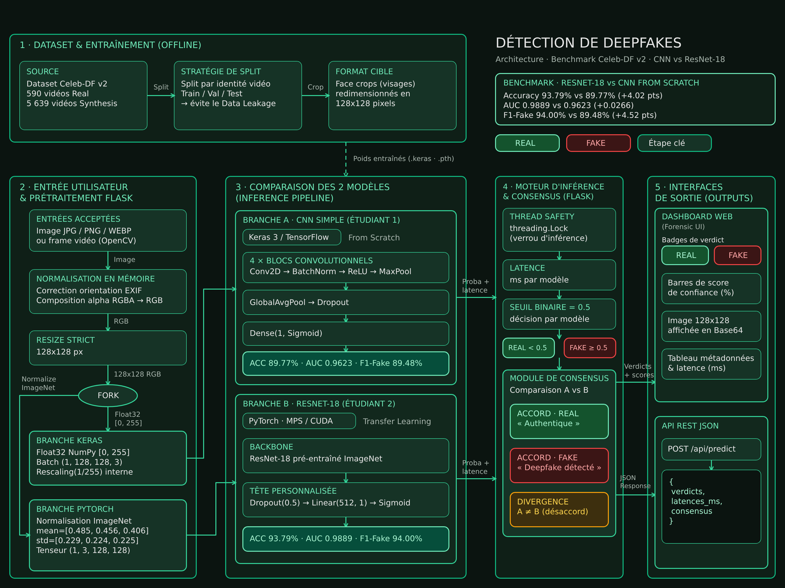

# Détection de deepfakes — Celeb-DF v2

Classifieur binaire (REAL / FAKE) sur des crops de visage issus de **Celeb-DF v2**, avec une
application Flask qui compare en direct deux architectures indépendantes :

| Modèle | Rôle | Cadre |
|---|---|---|
| **ResNet-18** (Étudiant 2) | transfer learning ImageNet, fine-tuning | PyTorch |
| **CNN Simple** (Étudiant 1) | réseau convolutif entraîné de zéro | Keras 3 / TensorFlow |

> Pour comprendre le projet pas à pas (rôle de chaque fichier, notions à maîtriser, étapes
> restantes, questions de soutenance) : **[docs/guide-projet.md](docs/guide-projet.md)**.

---

## ⚠️ Statut des métriques

**Les chiffres historiques du projet ne sont pas reproductibles par le code actuel.** Ils sont
conservés ci-dessous pour mémoire, mais ne doivent pas être présentés comme les résultats de
cette version.

| Modèle | Accuracy | AUC | Precision (FAKE) | Recall (FAKE) | F1 (FAKE) | Statut |
|---|---|---|---|---|---|---|
| ResNet-18 | 93,79 % | 98,89 % | 90,75 % | 97,50 % | 94,00 % | archivé, non reproductible |
| CNN Simple | 89,77 % | 96,23 % | 91,95 % | 87,15 % | 89,48 % | **invalide** (voir ci-dessous) |

Trois raisons :

1. `result_etudiant2/resnet18_history.csv` a un schéma de colonnes différent de celui produit par
   le notebook ; ces artefacts proviennent d'une version antérieure du code.
2. Le fichier `cnn_simple.keras` livré contient ses **couches d'augmentation dans son graphe**.
   À l'inférence, la même image pouvait changer de verdict (mesuré : 6 images sur 20, avec des
   probabilités allant de 0,04 à 0,98 pour une même image). Les 89,77 % du CNN ont donc été
   calculés sur des images bruitées, pas sur un classifieur déterministe.
3. Toutes les métriques étaient calculées **au niveau frame**, alors que les frames d'une même
   vidéo sont presque identiques : le niveau vidéo (bien plus bas) n'était pas rapporté.

### Ce qui est mesuré aujourd'hui

Le code corrige les deux défauts : le CNN est chargé sans ses couches aléatoires (avec test de
déterminisme au démarrage) et l'évaluation rapporte les deux niveaux. Sur les **20 échantillons**
fournis dans `echantillons_20_photos/` — échantillon minuscule, donné comme contrôle de bon
fonctionnement et non comme résultat :

| Modèle | Verdicts corrects | Consensus entre les deux modèles |
|---|---|---|
| ResNet-18 | **17 / 20** | 18 / 20 |
| CNN Simple (déterministe) | **15 / 20** | |

Pour obtenir de vraies métriques, relancer l'évaluation sur le split de test complet :

```bash
python scripts/evaluate_on_split.py \
  --dataset Celeb_V2 \
  --splits result_etudiant1/split_par_video.csv
```

Le script calcule le seuil sur la validation, évalue au niveau frame **et** vidéo, ajoute un
intervalle de confiance bootstrap et un test de McNemar, puis écrit
`result_etudiant2/reevaluation/metrics.json` et `predictions.csv`.

---

## Architecture



> Schéma de la **version initiale**. Les corrections apportées depuis sont : détection et
> recadrage du visage avant l'inférence, CNN chargé sans couches stochastiques, seuil de décision
> lu depuis `model_card.json` (choisi sur la validation) et métriques au niveau vidéo.

---

## Structure du dépôt

```
DeepLearningProjetCode/
├── app.py                              # Application Flask (routes, rendu, erreurs)
├── model_card.json                     # Contrat entraînement ↔ déploiement
├── requirements.txt                    # Dépendances d'exécution
├── requirements-dev.txt                # Notebook + tests
├── pyproject.toml                      # Configuration pytest
│
├── deepfake/                           # Code partagé (app, scripts, tests)
│   ├── config.py                       # carte de modèle, chemins
│   ├── preprocess.py                   # EXIF, alpha, resize bilinéaire 128×128, normalisation
│   ├── face.py                         # détection YuNet + recadrage du visage
│   ├── models.py                       # chargement strict, suppression des couches aléatoires
│   └── metrics.py                      # AUC, seuils, niveau vidéo, bootstrap, McNemar, ECE
│
├── templates/index.html                # Interface (Dark Forest / Forensic Minimal)
├── models/face_detection_yunet_2023mar.onnx
├── scripts/
│   ├── download_face_model.py          # télécharge YuNet (SHA-256 vérifié)
│   ├── export_inference_model.py       # exporte un CNN déterministe
│   └── evaluate_on_split.py            # métriques frame + vidéo, IC95, McNemar
│
├── deepfake-resnet18-etudiant2.ipynb   # Entraînement + évaluation ResNet-18
├── resnet18.pt                         # Poids ResNet-18
├── cnn_simple.keras                    # Poids CNN Simple (couches aléatoires retirées au chargement)
│
├── echantillons_20_photos/             # 20 crops étiquetés pour la démonstration
├── result_etudiant1/                   # Artefacts CNN Simple (historiques)
├── result_etudiant2/                   # Artefacts ResNet-18 (historiques)
│
├── tests/                              # 45 tests (pytest)
└── docs/
    ├── guide-projet.md                 # Comprendre, terminer, soutenir (étapes pas à pas)
    └── revue-initiale.md               # Audit initial, postes corrigés
```

---

## Modèles

### ResNet-18 — `resnet18.pt`

| Composant | Détail |
|---|---|
| Entrée | 128 × 128 × 3, normalisée ImageNet |
| Backbone | `torchvision.models.resnet18`, poids ImageNet |
| Tête | `Dropout(0.5) → Linear(512, 1)` |
| Perte | BCEWithLogits |
| Inférence | `sigmoid(logit)` |
| Device | CUDA → MPS → CPU |

### CNN Simple — `cnn_simple.keras`

| Composant | Détail |
|---|---|
| Entrée | 128 × 128 × 3, pixels 0–255 |
| Normalisation | `Rescaling(1/255)` intégrée |
| Backbone | 4 × `Conv2D → BatchNorm → ReLU → MaxPool` |
| Tête | `GlobalAveragePooling → Dropout → Dense(1, sigmoid)` |
| Optimiseur | Adam |

> **Point important.** L'artefact livré embarque ses couches `RandomFlip`, `RandomRotation`,
> `RandomBrightness`, `RandomContrast` et `Dropout` dans le graphe, et elles s'appliquent à
> l'inférence. `deepfake.models.load_cnn` reconstruit un graphe déterministe à poids identiques,
> puis `check_determinism` vérifie que deux appels identiques donnent les mêmes sorties. Le
> démarrage de l'application échoue explicitement si ce n'est pas le cas.

---

## Dataset et split

`result_etudiant1/split_par_video.csv` (colonnes `rel_path,label,video,split`) :

| Split | Images | FAKE | Vidéos |
|---|---|---|---|
| train | 80 798 | 50,2 % | — |
| validation | 10 078 | 50,3 % | — |
| test | 10 155 | 49,9 % | — |

- Labels : `0 = REAL`, `1 = FAKE`.
- Split **par vidéo** : le notebook vérifie qu'aucune vidéo n'apparaît dans deux splits.
- Limite connue : la séparation par vidéo n'empêche pas une fuite d'**identité** (une personne
  filmée dans un vrai clip d'entraînement peut apparaître dans un faux clip de test).
- Celeb-DF v2 n'est pas distribué ici : voir ses [conditions d'utilisation](https://github.com/yuezunli/celeb-deepfakeforensics).

---

## Application web

```bash
python app.py
# → http://localhost:5001
```

### Pipeline d'inférence

```
Image / vidéo (n'importe quelle résolution)
  │
  ├─ décodage + EXIF + alpha sur fond blanc → RGB
  ├─ détection YuNet → plus grand visage détecté (aucun visage ⇒ erreur 422 explicite)
  ├─ recadrage carré avec marge de 25 % (borné à l'image)
  └─ resize bilinéaire 128 × 128
        ├─ normalisation ImageNet  → ResNet-18
        └─ pixels 0–255            → CNN Simple (Rescaling interne)
```

Aucune image sans visage détectable n'est analysée : c'était la principale cause de prédictions
silencieusement fausses sur les photos ordinaires.

### Routes

| Méthode | Chemin | Description |
|---|---|---|
| `GET` / `POST` | `/` | Interface (upload et analyse) |
| `POST` | `/demo` | Échantillon aléatoire du dépôt, avec vérité terrain affichée |
| `POST` | `/api/predict` | API JSON |
| `GET` | `/health` | État du chargement, device, seuil, erreurs |

### Codes d'erreur de l'API

| Code | `error` | Cause |
|---|---|---|
| 400 | `missing_file` / `unreadable` | fichier absent ou illisible |
| 413 | `file_too_large` | au-delà de 32 Mo |
| 422 | `no_face` | aucun visage détecté |
| 503 | `detector_unavailable` | OpenCV ou modèle YuNet absent |
| 500 | `internal_error` | erreur inattendue (journalisée, non détaillée) |

### Exemple

```bash
curl -X POST http://localhost:5001/api/predict \
  -F "file=@echantillons_20_photos/01_REAL_id35_0008_face_15135.jpg"
```

```json
{
  "status": "success",
  "consensus": true,
  "faces_detected": 1,
  "frames": null,
  "threshold": 0.5,
  "models": {
    "resnet18": {
      "verdict": "REAL", "confidence": 99.6,
      "prob_fake": 0.4, "prob_real": 99.6,
      "threshold": 0.5, "latency_ms": 7.3
    },
    "cnn_simple": {
      "verdict": "REAL", "confidence": 99.5,
      "prob_fake": 0.5, "prob_real": 99.5,
      "threshold": 0.5, "latency_ms": 16.5
    }
  }
}
```

`consensus` vaut `null` dès qu'un modèle est indisponible : l'interface affiche alors
« PARTIAL ANALYSIS » au lieu de prétendre à un accord.

### Vidéo

Cinq frames réparties sur la durée sont analysées ; les probabilités sont moyennées et le nombre
de frames exploitées est renvoyé. Une vidéo sans visage détectable est refusée (`422`).

---

## Installation

```bash
python3 -m venv venv
source venv/bin/activate
pip install -r requirements.txt      # application
pip install -r requirements-dev.txt  # notebook + tests (facultatif)
```

Python : testé avec 3.14 et TensorFlow 2.22 ; TensorFlow 2.15+ impose ses propres contraintes de
version, vérifier la compatibilité avec votre interpréteur.

Le détecteur de visages est fourni (`models/face_detection_yunet_2023mar.onnx`, 227 Ko, licence
MIT/OpenCV Zoo). Pour le retélécharger :

```bash
python scripts/download_face_model.py
```

### Variables d'environnement

| Variable | Défaut | Description |
|---|---|---|
| `PORT` | `5001` | port préféré (repli automatique si occupé) |
| `HOST` | `127.0.0.1` | interface d'écoute (`0.0.0.0` pour exposer) |
| `FLASK_SECRET_KEY` | clé de développement | secret de session Flask |
| `LOG_LEVEL` | `INFO` | verbosité des journaux |
| `FLASK_DEBUG` | `0` | `1` pour le mode debug Flask |

> macOS : AirPlay occupe le port 5000, l'application démarre sur 5001.

---

## Tests

```bash
pytest                    # tout (45 tests, ~10 s hors téléchargement de poids)
pytest -m "not models"    # tests rapides, sans PyTorch/TensorFlow
```

Couverture : métriques (AUC, seuils, agrégation vidéo, McNemar, ECE), prétraitement (EXIF, alpha,
normalisation), détection de visages, chargement des modèles, API Flask (200/400/404/413/422/503)
et non-régression du déterminisme du CNN.

Un workflow GitHub Actions (`.github/workflows/ci.yml`) est fourni : compilation de tous les
modules et tests rapides à chaque push, une fois ce fichier versionné.

---

## Reproduire l'entraînement

Le notebook `deepfake-resnet18-etudiant2.ipynb` est autonome (aucun import du package `deepfake`).
Il attend un CSV `rel_path,label,video,split` et le dataset Celeb-DF v2 extrait.

| Variable | Rôle |
|---|---|
| `DEEPFAAKE_DATASET_DIR` | racine des images |
| `DEEPFAAKE_SPLIT_CSV` | CSV du split |
| `DEEPFAAKE_OUTPUT_DIR` | dossier des artefacts |
| `DEEPFAAKE_EPOCHS_HEAD` / `DEEPFAAKE_EPOCHS_FINETUNE` | nombre d'époques |
| `DEEPFAAKE_BATCH_SIZE`, `DEEPFAAKE_WORKERS`, `DEEPFAAKE_SEED`, `DEEPFAAKE_AMP` | réglages |

Sans variables d'environnement, le notebook détecte automatiquement `/kaggle/input`. Les
métadonnées Kaggle sont configurées pour **GPU + Internet activés** (les poids ImageNet sont
téléchargés au premier lancement).

Sorties dans `result_etudiant2/reproduction/` :

```
resnet18_best.pt          meilleur checkpoint (sélection sur l'AUC de validation)
resnet18_history.csv      historique par époque et par phase
predictions.csv           probabilités par image de test
resnet18_courbes.png      pertes / exactitude / AUC, séparées par phase
resnet18_roc_pr.png       ROC et précision-rappel
resnet18_confusion.png    matrice de confusion
resnet18_calibration.png  diagramme de fiabilité (ECE)
resnet18_erreurs.png      12 erreurs les plus confiantes
resnet18_gradcam.png      Grad-CAM sur vrais positifs et faux négatifs
cnn_simple_inference.keras  CNN sans couches aléatoires
model_card.json           seuil retenu + métriques (à copier à la racine pour le déploiement)
```

Le notebook rapporte les métriques **frame et vidéo**, un IC95 bootstrap, un test de McNemar
entre les deux modèles et un test de robustesse à la recompression JPEG (q=90/70/50).

### Régénérer l'artefact CNN

```bash
python scripts/export_inference_model.py
# vérifie le déterminisme, retire les couches aléatoires, écrit cnn_simple_inference.keras
```

---

## Limites

- Une prédiction porte sur un **crop de visage** : elle ne prouve pas qu'une vidéo entière est
  truquée. Aucune analyse temporelle (cohérence inter-frames) ni audio n'est réalisée.
- Celeb-DF v2 contient une seule famille de manipulations (FaceSwap) : la généralisation à
  d'autres générateurs n'est pas garantie.
- Les probabilités ne sont pas garanties calibrées (voir l'ECE du notebook) : les afficher comme
  « confiance » est optimiste.
- Le seuil de décision est un compromis ; selon l'usage (modération, expertise forensique), il
  faut choisir le point de la courbe précision-rappel en fonction du coût des erreurs.

## Licence

Projet universitaire, usage académique uniquement. Le dataset Celeb-DF v2 est soumis à ses
[propres conditions](https://github.com/yuezunli/celeb-deepfakeforensics) ; le détecteur YuNet
provient d'OpenCV Zoo (licence MIT).
